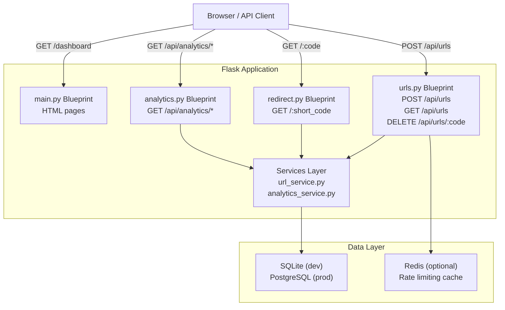
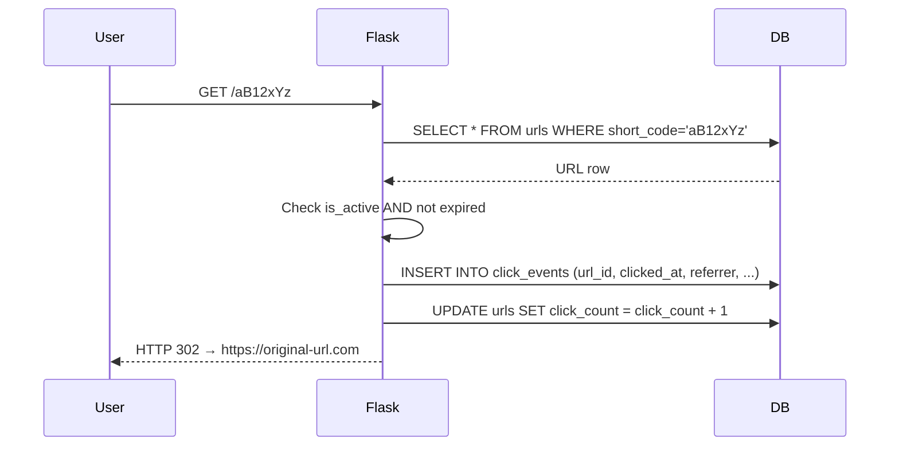
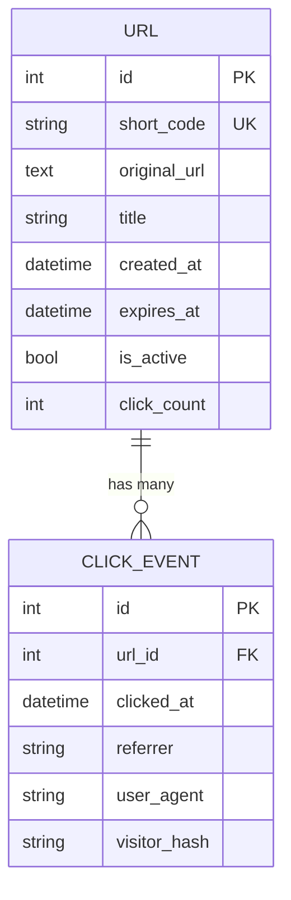

# 🔗 Distributed URL Shortener & Event Tracking System
> **Project ID:** BE-04 · **Specialization:** Backend Development  
> **Stack:** Python · Flask · SQLAlchemy · SQLite/PostgreSQL · Chart.js
A professional-grade URL shortening service with real-time analytics, REST API, and a modern SaaS-style dashboard. Built as a complete internship project demonstrating backend architecture, database design, event tracking, security, and testing.
---
## 📋 Table of Contents
1. [Overview](#overview)
2. [Problem Statement](#problem-statement)
3. [Objectives](#objectives)
4. [Technology Stack](#technology-stack)
5. [System Architecture](#system-architecture)
6. [Database Schema](#database-schema)
7. [Features](#features)
8. [Installation (Windows)](#installation-windows)
9. [Running the Application](#running-the-application)
10. [API Documentation](#api-documentation)
11. [Testing](#testing)
12. [Screenshots](#screenshots)
13. [Known Limitations](#known-limitations)
14. [Future Enhancements](#future-enhancements)
15. [GitHub Setup](#github-setup)
---
## Overview
**LinkSnap** is a distributed URL shortener that converts long, unwieldy URLs into short, trackable links. Every redirect is recorded as a click event, enabling real-time analytics including click trends, referrer analysis, and per-URL performance metrics.
The project is designed for extensibility: the local SQLite development setup can be swapped for PostgreSQL + Redis in production with only environment variable changes.
---
## Problem Statement
Long URLs are:
- Difficult to share in social media, emails, and printed materials
- Impossible to track (no click data)
- Opaque to the recipient (destination is unknown)
- Not manageable (cannot expire or deactivate)
This system solves all four problems with a clean API and a visual dashboard.
---
## Objectives
- [x] Shorten any `http://` or `https://` URL to a 7-character code
- [x] Track every redirect as a timestamped click event
- [x] Provide real-time analytics with Chart.js visualizations
- [x] Expose a complete REST API with proper HTTP status codes
- [x] Support optional link expiration
- [x] Implement rate limiting on URL creation
- [x] Store visitor analytics without storing raw IP addresses (privacy)
- [x] Write automated test suites covering 50+ scenarios
- [x] Document architecture, API, and testing comprehensively
- [x] Provide a path to PostgreSQL + Redis distributed deployment
---
## Technology Stack
|
 Layer 
|
 Technology 
|
 Purpose 
|
|
-------
|
-----------
|
---------
|
|
 Language 
|
 Python 3.12 
|
 Core application 
|
|
 Web Framework 
|
 Flask 3.0 
|
 HTTP routing, blueprints 
|
|
 ORM 
|
 SQLAlchemy 2.0 
|
 Database abstraction 
|
|
 Database (dev) 
|
 SQLite 
|
 Zero-config local development 
|
|
 Database (prod) 
|
 PostgreSQL 16 
|
 Production persistence 
|
|
 Cache (optional) 
|
 Redis 7 
|
 Rate limiting, caching 
|
|
 Rate Limiting 
|
 Flask-Limiter 
|
 Abuse prevention 
|
|
 Frontend 
|
 HTML5 + CSS3 + JavaScript 
|
 Dashboard UI 
|
|
 Charts 
|
 Chart.js 4.x 
|
 Analytics visualizations 
|
|
 Testing 
|
 pytest + pytest-flask 
|
 Automated test suite 
|
|
 Container 
|
 Docker + Docker Compose 
|
 Distributed deployment 
|
---
## System Architecture

### Request Flow for Redirect

---
## Database Schema

### Index Strategy
|
 Table 
|
 Column 
|
 Type 
|
 Purpose 
|
|
-------
|
--------
|
------
|
---------
|
|
 urls 
|
 short_code 
|
 UNIQUE 
|
 Fast redirect lookup 
|
|
 urls 
|
 created_at 
|
 INDEX 
|
 Time-range queries 
|
|
 urls 
|
 is_active 
|
 INDEX 
|
 Filter deleted URLs 
|
|
 click_events 
|
 url_id 
|
 INDEX 
|
 Per-URL analytics 
|
|
 click_events 
|
 clicked_at 
|
 INDEX 
|
 Time-series queries 
|
---
## Features
### ✅ Implemented
|
 Feature 
|
 Details 
|
|
---------
|
---------
|
|
 URL Shortening 
|
 7-char cryptographically random codes (62^7 ≈ 3.5T combinations) 
|
|
 Custom Short Codes 
|
 User-defined slugs (3-20 chars, alphanumeric + hyphen/underscore) 
|
|
 Link Expiration 
|
 Optional ISO-8601 expiry date; expired links return 410 Gone 
|
|
 Click Tracking 
|
 Every redirect recorded with timestamp, referrer, user-agent 
|
|
 Privacy 
|
 Visitor identified by daily SHA-256 hash — no raw IPs stored 
|
|
 Rate Limiting 
|
 30 creates/minute, 200/hour per IP 
|
|
 Analytics Dashboard 
|
 Total URLs, clicks, trends, top URLs, recent events 
|
|
 Chart.js Charts 
|
 Line chart (clicks/day), bar chart (URLs created/day), per-URL chart 
|
|
 Search & Pagination 
|
 Server-side filtering and paginated URL listing 
|
|
 REST API 
|
 Full CRUD with consistent JSON responses and HTTP status codes 
|
|
 Soft Delete 
|
 URLs are deactivated, not hard-deleted; click history preserved 
|
|
 Error Handling 
|
 JSON error responses; no stack traces exposed 
|
### 🔧 Optional (requires Redis/PostgreSQL)
|
 Feature 
|
 Enable With 
|
|
---------
|
------------
|
|
 Redis-backed rate limiting 
|
`REDIS_URL`
 env var 
|
|
 PostgreSQL persistence 
|
`DATABASE_URL=postgresql://...`
|
|
 Docker Compose stack 
|
`docker-compose up`
|
---
## Installation (Windows)
### Prerequisites
- Python 3.10 or newer: https://www.python.org/downloads/
- Git: https://git-scm.com/downloads
### Step 1 — Clone the repository
```powershell
git clone https://github.com/YOUR_USERNAME/url-shortener-system.git
cd url-shortener-system
```
### Step 2 — Create a virtual environment
```powershell
python -m venv venv
```
### Step 3 — Activate the virtual environment
```powershell
venv\Scripts\Activate.ps1
```
> If you get an execution policy error, run:
> `Set-ExecutionPolicy -ExecutionPolicy RemoteSigned -Scope CurrentUser`
### Step 4 — Install dependencies
```powershell
pip install -r requirement.txt
```
### Step 5 — Configure environment variables
```powershell
Copy-Item .env.example.txt .env
# Edit .env with your preferred text editor if needed
```
### Step 6 — Initialize the database
The database is created automatically on first run. No separate migration step is needed for development.
---
## Running the Application
```powershell
# Make sure venv is active
venv\Scripts\Activate.ps1
# Start Flask development server
python run.py
```
Open your browser at **http://127.0.0.1:5000**
### Available Pages
|
 URL 
|
 Description 
|
|
-----
|
-------------
|
|
 http://127.0.0.1:5000/ 
|
 Home — URL creation form 
|
|
 http://127.0.0.1:5000/dashboard 
|
 URL management table 
|
|
 http://127.0.0.1:5000/analytics 
|
 Analytics charts 
|
|
 http://127.0.0.1:5000/api/analytics/overview 
|
 JSON overview stats 
|
---
## API Documentation
### Base URL
```
http://127.0.0.1:5000
```
### Authentication
No authentication required for this development version. Production deployments should add API key or JWT authentication.
---
### POST /api/urls
Create a new shortened URL.
**Request Body (JSON)**
```json
{
  "url": "https://www.example.com/very-long-path",
  "title": "My Link",
  "expires_at": "2025-12-31T23:59:59",
  "custom_code": "my-slug"
}
```
|
 Field 
|
 Type 
|
 Required 
|
 Notes 
|
|
-------
|
------
|
----------
|
-------
|
|
 url 
|
 string 
|
 ✅ 
|
 Must be http:// or https:// 
|
|
 title 
|
 string 
|
 ❌ 
|
 Max 255 chars 
|
|
 expires_at 
|
 ISO-8601 
|
 ❌ 
|
 Must be in the future 
|
|
 custom_code 
|
 string 
|
 ❌ 
|
 3-20 chars, alphanumeric + 
`-_`
|
**Response 201**
```json
{
  "url": {
    "short_code": "aB12xYz",
    "short_url": "http://127.0.0.1:5000/aB12xYz",
    "original_url": "https://www.example.com/very-long-path",
    "title": "My Link",
    "created_at": "2024-10-22T14:30:00+00:00",
    "expires_at": null,
    "is_active": true,
    "is_expired": false,
    "click_count": 0
  }
}
```
**Error Responses**
|
 Code 
|
 Reason 
|
|
------
|
--------
|
|
 400 
|
 Invalid URL, bad expires_at, invalid custom code 
|
|
 409 
|
 Custom code already taken 
|
|
 429 
|
 Rate limit exceeded 
|
---
### GET /api/urls
List shortened URLs with pagination.
**Query Parameters**
|
 Param 
|
 Default 
|
 Notes 
|
|
-------
|
---------
|
-------
|
|
 page 
|
 1 
|
 Page number 
|
|
 per_page 
|
 20 
|
 Max 100 
|
|
 search 
|
 — 
|
 Filter on URL or short code 
|
**Response 200**
```json
{
  "urls": [...],
  "page": 1,
  "per_page": 20,
  "total": 42,
  "pages": 3
}
```
---
### GET /api/urls/{short_code}
Retrieve a single URL's metadata.
**Response 200** — Same URL object as POST response.  
**Response 404** — Short code not found.
---
### GET /api/urls/{short_code}/analytics
Per-URL analytics for the last N days.
**Query Parameters**
|
 Param 
|
 Default 
|
 Range 
|
|
-------
|
---------
|
-------
|
|
 days 
|
 30 
|
 7-365 
|
**Response 200**
```json
{
  "url": { ... },
  "daily_clicks": [
    { "date": "2024-10-01", "clicks": 12 },
    ...
  ],
  "top_referrers": [
    { "referrer": "https://google.com", "count": 8 }
  ],
  "clicks_in_window": 47,
  "window_days": 30
}
```
---
### GET /api/analytics/overview
Global dashboard statistics.
**Response 200**
```json
{
  "total_urls": 24,
  "total_clicks": 1082,
  "clicks_today": 47,
  "active_urls": 22,
  "most_popular": [...],
  "recent_clicks": [...]
}
```
---
### GET /api/analytics/clicks-over-time
Daily click counts (for the clicks chart).
**Query Params:** `days` (7-365, default 30)
---
### GET /api/analytics/url-creation-trend
Daily new URL counts (for the creation trend chart).
---
### DELETE /api/urls/{short_code}
Soft-delete a URL (deactivates it; click history preserved).
**Response 200**
```json
{ "message": "URL deleted successfully." }
```
---
### GET /{short_code}
Redirect to the original URL.
|
 Code 
|
 Condition 
|
|
------
|
-----------
|
|
 302 
|
 Success — redirect 
|
|
 404 
|
 Short code not found or deactivated 
|
|
 410 
|
 URL has expired 
|
---
## Testing
### Run All Tests
```powershell
venv\Scripts\Activate.ps1
pytest tests/ -v
```
### Run Specific Test Files
```powershell
pytest tests/test_urls.py -v
pytest tests/test_redirects.py -v
pytest tests/test_analytics.py -v
```
### Test Coverage Report
```powershell
pip install pytest-cov
pytest tests/ --cov=app --cov-report=html
# Open htmlcov/index.html in browser
```
### Test Summary
|
 File 
|
 Scenarios 
|
 Coverage Area 
|
|
------
|
-----------
|
---------------
|
|
 test_urls.py 
|
 20 
|
 URL creation, validation, listing, pagination, deletion 
|
|
 test_redirects.py 
|
 9 
|
 Redirect flow, expiry, click recording, referrers 
|
|
 test_analytics.py 
|
 13 
|
 Overview stats, time-series, per-URL analytics 
|
---
## Screenshots
> Screenshots must be captured after running the application locally.
**To capture screenshots:**
1. Start the app: `python run.py`
2. Open http://127.0.0.1:5000 — capture the home/URL creation page
3. Create 2-3 test URLs, visit the short URLs a few times
4. Open http://127.0.0.1:5000/dashboard — capture the URL table
5. Open http://127.0.0.1:5000/analytics — capture the charts
Place screenshots in a `docs/screenshots/` folder and update this section with image paths.
---
## Known Limitations
|
 Limitation 
|
 Notes 
|
|
-----------
|
-------
|
|
 No authentication 
|
 All URLs are visible to anyone with access to the app. Add JWT/session auth for multi-user production use. 
|
|
 SQLite not suitable for production 
|
 Use 
`DATABASE_URL=postgresql://...`
 for concurrent write workloads. 
|
|
 No HTTPS 
|
 The dev server uses plain HTTP. Use Nginx + Let's Encrypt in production. 
|
|
 Rate limiting resets on restart 
|
 Memory-based limiter loses state. Set 
`REDIS_URL`
 for persistent rate limits. 
|
|
 No user accounts 
|
 URLs are not tied to user sessions. 
|
|
 Click deduplication 
|
 Approximate unique visitor tracking via daily hash; not a true deduplication system. 
|
---
## Future Enhancements
- [ ] User accounts and authentication (Flask-Login or JWT)
- [ ] QR code generation for each short URL
- [ ] Bulk URL import via CSV
- [ ] Webhook notifications on click thresholds
- [ ] Geographic analytics (IP-to-country with a privacy-respecting lookup)
- [ ] URL preview page (show destination before redirecting)
- [ ] API key authentication for programmatic access
- [ ] Horizontal scaling with Redis-based distributed rate limiting
- [ ] Background Celery worker for async event processing
- [ ] Admin panel for URL moderation
---
## GitHub Setup
```powershell
# Initialize a new repository
git init
git add .
git commit -m "feat: initial project — Distributed URL Shortener & Event Tracking System"
# Push to GitHub (create repo first at github.com)
git remote add origin https://github.com/YOUR_USERNAME/url-shortener-system.git
git branch -M main
git push -u origin main
```
### Branch Strategy
```
main           ← stable, always passes tests
develop        ← active development
feature/*      ← individual feature branches
```
---
## Project Structure
```
url-shortener-system/
├── app.py                          # Entry point
├── config.py                       # Environment-driven config
├── requirements.txt
├── .env.example
├── .gitignore
├── Dockerfile
├── docker-compose.yml
├── README.md
│
├── app/
│   ├── __init__.py                 # App factory + blueprint registration
│   ├── extensions.py               # Shared db, limiter instances
│   ├── models/
│   │   ├── url.py                  # URL model
│   │   └── click_event.py          # ClickEvent model
│   ├── routes/
│   │   ├── main.py                 # HTML page routes
│   │   ├── urls.py                 # /api/urls REST endpoints
│   │   ├── analytics.py            # /api/analytics REST endpoints
│   │   └── redirect.py             # /<short_code> redirect handler
│   ├── services/
│   │   ├── url_service.py          # URL creation, validation, deletion
│   │   └── analytics_service.py    # Aggregation queries
│   ├── templates/
│   │   ├── base.html               # Base layout with sidebar
│   │   ├── index.html              # Home/URL creation
│   │   ├── dashboard.html          # URL management table
│   │   ├── analytics.html          # Charts and statistics
│   │   └── expired.html            # 410 page
│   └── static/
│       └── css/
│           └── style.css           # SaaS-style dark theme
│
├── tests/
│   ├── conftest.py                 # Pytest fixtures
│   ├── test_urls.py                # URL CRUD tests
│   ├── test_redirects.py           # Redirect and click tests
│   └── test_analytics.py           # Analytics endpoint tests
│
└── docs/
    ├── architecture.md
    ├── api_documentation.md
    └── testing.md
```
---
*Built with ❤️ as internship project BE-04 — Backend Development Specialization*